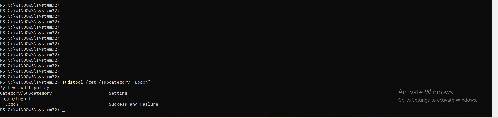
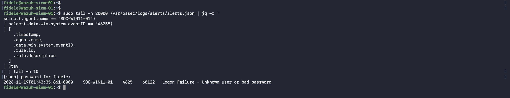
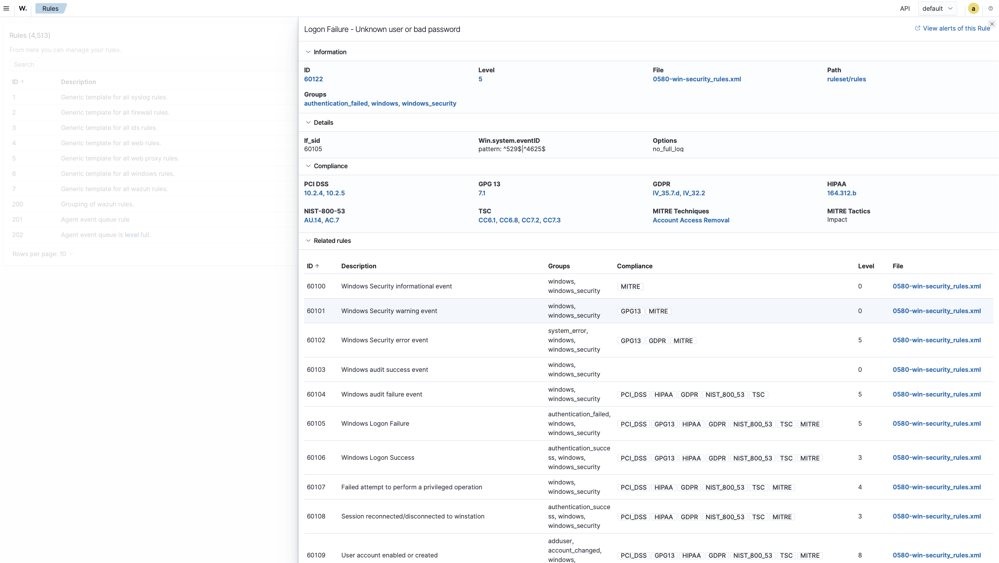
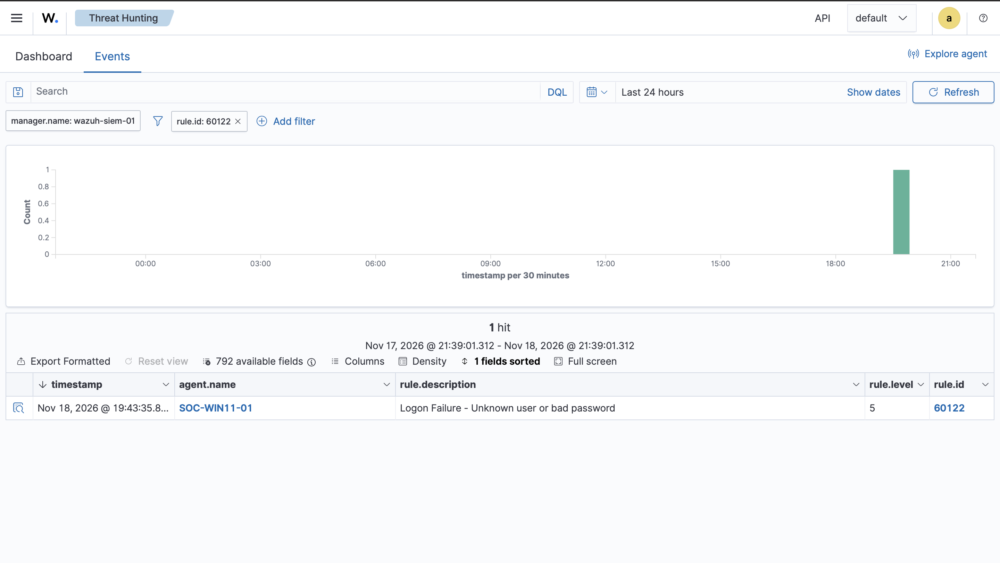
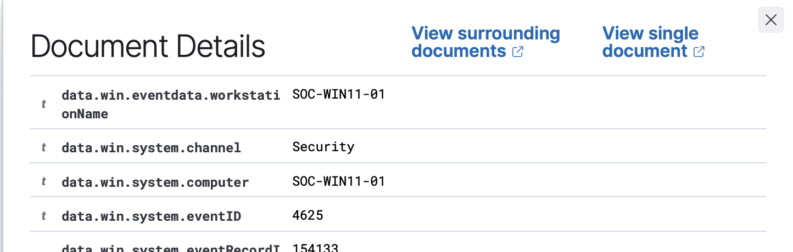

# SOC Investigation #002 — Windows Failed Login Detection

**Hands-on blue-team investigation | Windows Security Event ID 4625 • Wazuh SIEM • Alert triage**

> **Disposition:** Benign — authorized lab authentication test. **Detection validation: PASS.** No compromise or malicious activity was established.

## Objective
Validate end-to-end collection and alerting for a deliberately failed Windows authentication, examine the resulting SIEM alert, and distinguish a detection rule's automated MITRE mapping from behavior actually supported by evidence.

## Lab environment
| Component | Role |
|---|---|
| `SOC-WIN11-01` | Windows 11 ARM64 monitored endpoint |
| Windows Security log | Authentication audit records (Event ID `4625`) |
| Wazuh Windows agent | Forwards endpoint events |
| `wazuh-siem-01` | Ubuntu Server Wazuh manager, indexer, dashboard |
| VMware Fusion | Virtualization platform |

**Pipeline:** Controlled rejected credentials → Windows Security `4625` → Wazuh agent → Wazuh rule `60122` → Threat Hunting dashboard.

## Key findings
| Field | Observed value |
|---|---|
| Event ID | `4625` — An account failed to log on |
| Wazuh rule | `60122` — Logon Failure - Unknown user or bad password |
| Wazuh severity | Level `5` (rule severity, **not** analyst severity) |
| Endpoint | `SOC-WIN11-01` |
| Target username | `SOC-Lab-Test-User` (nonexistent lab account) |
| Logon type | `2` — Interactive |
| Status / substatus | `0xC000006D` / `0xC0000064` (unknown user) |
| Source address | `::1` — IPv6 loopback |
| Authentication package | `Negotiate` |
| Caller process | `C:\Windows\System32\svchost.exe` |
| Wazuh alert timestamp | `2026-11-19T01:43:35.861+0000` (UTC) |
| Matching dashboard result | One alert in the selected 24-hour window |

## Detection evidence

### 1. Windows auditing configured

### 2. Wazuh alert in manager JSON log

### 3. Wazuh rule configuration

### 4. Threat Hunting — matching event

### 5. Event document details (privacy-safe crop)

## MITRE ATT&CK interpretation
Wazuh rule `60122` attached **T1531 — Account Access Removal** (Impact). The observed event is **only a failed interactive logon**; it does not establish account deletion, disabling, credential changes, or account access removal. The automatic mapping is recorded as a **mapping limitation for this case**, not an observed attack technique.

## Analyst conclusion
**Likely cause:** Intentionally rejected credentials for a nonexistent local test user. **Classification:** Benign / authorized testing. **Analyst-assessed risk:** Low in this controlled context. **Escalation:** Not warranted for this test event. This conclusion is limited to the single observed test and does not imply all rule 60122 alerts are benign.

## Full report
[Read the investigation report](reports/Windows-Failed-Login-Investigation.md).

## Reproducibility and limits
- Auditing was verified with `auditpol /get /subcategory:"Logon"` returning `Success and Failure`.
- An unsuccessful credential-based `Start-Process` test generated the matching local `4625` event; an earlier `runas` attempt did not confirm an event.
- The Wazuh manager JSON log and Threat Hunting interface each confirmed the detection.
- No brute-force activity, successful unauthorized logon, or remote origin was demonstrated.
- Screenshots have been selected/cropped to avoid exposing the full Windows SID; review all assets before public upload.
- This is a controlled educational lab, not a production incident.

**Related:** [SOC Home Lab — Wazuh & Sysmon](https://github.com/sassefidele/SOC-Home-Lab-Wazuh-Sysmon) · [SOC Investigation #001](https://github.com/sassefidele/SOC-Investigation-01-Account-Discovery)
